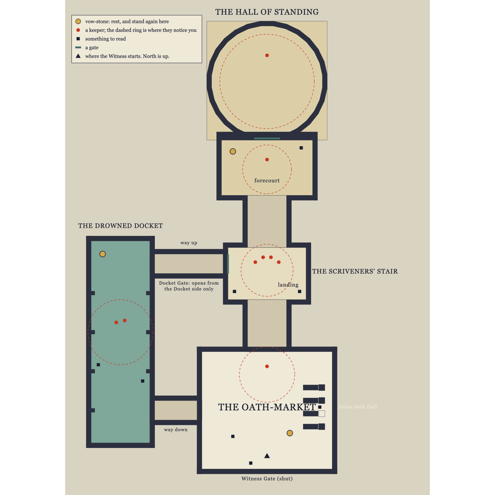

# 13. The Assize Quarter (as built)

Status: **built, tested headless and captured twice** (M5, first session,
2026-11-13). See `STATUS.md` for what the captures showed. This document describes what exists. The plan
below is drawn by a script from the district's real collision blocks and
data (`game/tools/map_quarter.gd`), so it cannot drift from the build.

## The idea

One district of Veyr, the City of Crowns, on the day after a vow broke
there. In Veyr a vow spoken before a witness cannot break. The Court says
nothing happened. Eleven people heard it. The player is the witness nobody
will admit to having been.

The district is a loop with a climb at the end: a square, a way up, a way
under, and the place where the Court will hear you.

## Four places

| Place | Floor | What it is | Who keeps it |
|---|---|---|---|
| **The Oath-Market** | 0 m | A square, 40 by 36 m. The Witness Gate is sealed behind you. Brokers' stalls with nobody at them. Vows hang over it as gold lines; one lies broken, in vermilion, where the Oath Hall stood. The Court has hung a black bar across the gap | A Bailiff at the foot of the Stair |
| **The Scriveners' Stair** | 0 to 8 m | Two flights of sixteen steps and a landing of copyists' desks, then the forecourt before the Hall, hung with the Court's banners | Four Clerks on the landing; a Bailiff with a Warrant on the forecourt |
| **The Drowned Docket** | -4 m | A sunk archive, ankle-deep in green water, open to the sky and ribbed over with dark beams. Shelves of rolled dockets; the lowest rows have been under water | A Bailiff and his Ward, under Escort |
| **The Hall of Standing** | 8 m | A round court 34 m across, open to the sky, twelve columns at its wall | Aurel Voss |

Over the Hall hang the Hanging Courts: the upper city, widening as it
rises, its lowest point forty metres above the Arbiter's head, its chains
hanging down over the roofs and ending in the air. It casts no shadow on
the Quarter.

## How it connects

* Market north to the Stair, up to the landing, up to the forecourt, through
  the portal into the Hall.
* Market east down a ramp into the Docket; the Docket's far end climbs a
  second ramp to the **Docket Gate** on the landing.
* The gate opens only from the Docket's side. From the landing it reads "It
  does not open from this side." Once opened it stays open, and the Docket
  becomes the short way from the market to the landing.
* When the Witness walks into the Hall, the **Bar of Standing** comes down
  behind them. It lifts when Voss yields, or when the Witness falls.

No two places overlap in plan. The Law Engine's space is flat (laws ignore
height), so a line drawn on the landing must not also bar the Docket
beneath it; the layout guarantees it cannot.

## Vow-stones

Three: the Market Stone, the Docket Stone, the Stone of Standing.

| A vow-stone does | State |
|---|---|
| Restore health and Resonance | **Tested** |
| Become the place the Witness stands again after falling | **Tested** |
| Return every keeper to their post, whole. Not Voss, once he has yielded | **Tested** |
| Refuse while any post is roused | **Tested** |
| Let the Witness **swear a Vow**: E opens the stone's choices (rest, four Vows, step away). One at a time. Kept when a post is cleared under it; see `03_axiom_system.md` section 8 | **Tested**. Unseen |

The Stone of Standing is past the Bailiff with the Warrant, so he must be
dealt with before it can be used, and a fall to Voss is a short walk back.

## Those who keep each place

Keepers stand at their posts, visible from a distance, and do nothing until
the Witness comes within a radius (or strikes one of them). Roused, they
fight as they do in the yard. If the Witness goes beyond the post's leash,
or onto another level, they give up and walk back. A post whose keepers are
all down is cleared until the Witness rests or falls.

Their AI still moves in straight lines: there is no pathfinding. Every post
is in an open room so that this does not show. It will show the first time
a fight is dragged round a corner.

## What can be read

Eight records, each a few lines, read at a lectern or off a wall with E.
They follow the writing rules in `07_world_narrative.md`: people with jobs,
no lore dumps, and one record contradicts another.

| Record | Where | What it does |
|---|---|---|
| Notice of the Meridian Court | By the Witness Gate | "No vow was broken there." |
| Chalked on the fallen stone | The Oath Hall | "It broke. I heard it." Signed M.T. |
| An oath-broker's slate | A stall | Nobody will swear to anything today |
| A copyist's working sheet | The landing | Twelve Roots, thirteen ruled lines. Signed T.H. |
| A child's question | The landing | What holds the chains? |
| A docket, water-damaged | The Docket | A struck line in fresher ink than the water |
| A Bailiff's standing order | The Docket | How the Escort works, and so how to end it |
| Carved beside the portal | The forecourt | What Voss is bound by |

Two of them teach a counterplay without a tutorial. Two set up Maren Thole
and Tove Hallam, who do not exist in the game yet.

## How it is built

* **Stone is blocks.** `Massing` (`game/gameplay/world/massing.gd`) takes
  boxes, ramps and stairs, merges every block of one material into one
  mesh, and gives them one static body. The Quarter's architecture is 90
  solid blocks and a few hundred unsolid ones, drawn as one mesh of at most
  nine surfaces. Stairs are seen as steps and walked as a hidden ramp.
  There are no arches: a way through a wall is a lintel, which is the
  game's own motif.
* **Things are models.** Fourteen, made from scratch by
  `tools/blender/world.py` (vow-stone, lectern, stall, docket shelf, statue
  of an Arbiter, a plinth whose statue was struck, rubble, lamp, banner,
  gate panel, the Witness Gate, copyist's desk, and two set pieces: the
  Hanging Courts and the fallen Oath Hall), plus the yard's column. Review
  renders: `docs/screenshots/models/world/`.
* **Walls are dressed by rule.** `_face` gives a wall face a plinth, a
  cornice and pilasters; `stone_wall.gdshader` courses and joints the
  stone from world position, with no textures. A second, shadowless light
  models what is out of the sun.
* **Vows are written.** `_script` hangs a line of handwriting in the air:
  upright strokes in words, merged into the same mesh as everything else
  that is seen and never touched.
* **Who and what is data.** `game/data/world/assize_quarter.json`: areas,
  stones, encounters, records, gates.
* **The fight is the yard's.** `Quarter` extends `Arena`: the bridge, the
  player, the camera, the HUD and every law are the same code.

## What this is not yet

* It has been seen in stills and never in motion, and every capture so far
  was taken before the art pass of 2026-11-13.
* After one art pass it is a composed, stylised place of flat colour and
  ruled stone, with two real set pieces. It has no textures, no cloth, no
  foliage, no weathering, and its figures are still simple. Whether that
  is the game's look or a stage on the way to it is the owner's call.
* Nobody lives here. No brokers, no copyists, no Maren, Tove or Ysolde.
* Enemies do not know the Witness is sworn, and do nothing to make a Vow
  fall. The kept vows that hang on each stone as strips are set dressing:
  they do not count yours.
* The water is a surface. It does not slow, splash or sound.
* There is no sound of place and no music.
* The Witness Gate does not open and the oath that starts the story is not
  playable. That is M6.
